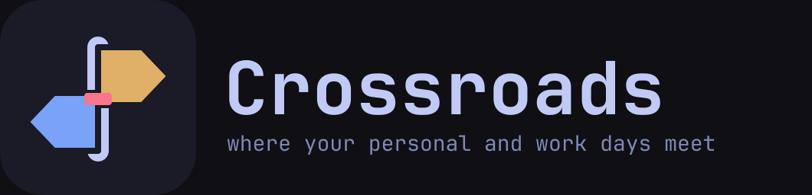
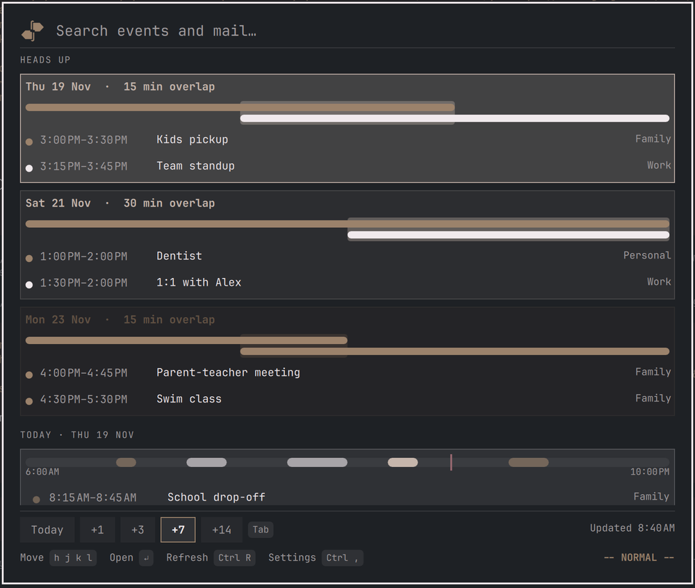
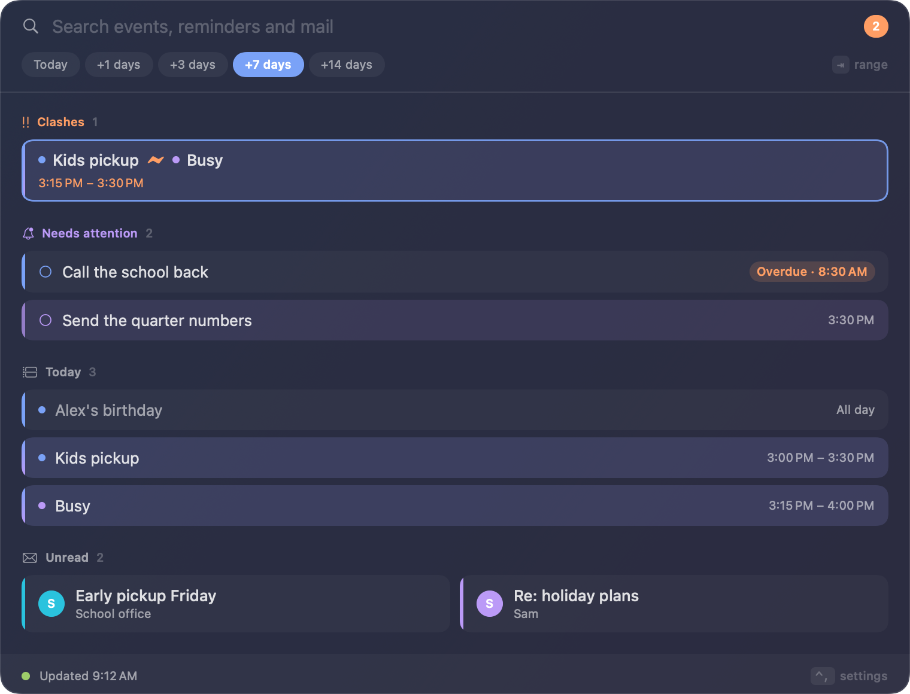

  

# Crossroads

I run my life across too many systems: a family calendar, a work calendar, a couple of inboxes, todos somewhere else. Answering something as simple as "can I take that 3pm call?" means opening four apps and stitching the answer together in my head.

Crossroads brings them into one place, so I can see everything at a glance and make a well-informed call in a fraction of the time. It starts with calendars and mail, and it's built to take in more.

## What it does

Crossroads brings into focus what needs your attention right now.

- **Conflicts.** A meeting that lands on school pickup shows up before it bites, along with exactly how long the two overlap. A personal event against a work event stands out from a double-booked work slot.
- **Today.** Your day as one strip, with a marker for now.
- **Unread mail.** What just came in, next to your day.

Everything is searchable, and one keypress opens the event or email where it lives.

  
   Omarchy. Made-up data. Colors follow your Omarchy theme.

  
   macOS. Made-up data.

## Status

| Platform | State |
| --- | --- |
| [Omarchy](omarchy/README.md) | Works today: an icon in the bar and a full view on Super+Alt+C. Reads Google Calendar, Gmail and iCloud Calendar. |
| macOS | In progress on [`macos`](../../tree/macos): a native app with a menu bar icon and a panel on ⌥⌘C, reading every calendar and Apple Reminders through EventKit. Gmail is not wired up yet. |

- Read-only and local. Crossroads never changes your calendars, reminders or mail, and it only talks to the services you connect.
- CI checks the specs and runs the tests on every push. There are no releases yet, so install from source.
- Early, and built for my own use first. Expect rough edges.

## Get started

- **Omarchy:** [install and setup](omarchy/README.md), then [connect your accounts](omarchy/docs/accounts.md).

## How it's built

- Each platform has its own folder and its own app: [`omarchy/`](omarchy) today, `macos/` next. What they share lives at the root.
- The rules live in [TLA+](https://lamport.azurewebsites.net/tla/tla.html) specs in [`specs/`](specs), and the specs are the source of truth for every platform:
  - **`ConflictFlags`** covers what counts as a conflict and which overlaps get a card.
  - **`Settings`** covers saving settings, calendar tags and the shortcut without ever corrupting a file or stealing another binding.

  The TLC model checker checks both specs. Every property has tests named after it on each platform.
- From the repository root, `make check` model-checks the specs and `make test` runs every platform's tests. `make check` needs `tlc`, or set `TLC` to a `java -cp tla2tools.jar tlc2.TLC` command.

## Privacy

- Passwords and tokens live in your system's keyring. They never go into config files, logs or snapshots.
- Google access is read-only. Crossroads reads calendars, and the sender and subject of unread mail. It never reads message bodies.
- There is no Crossroads server, no telemetry and no analytics.

## License

[MIT](LICENSE)
